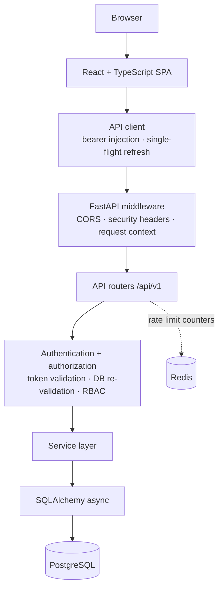
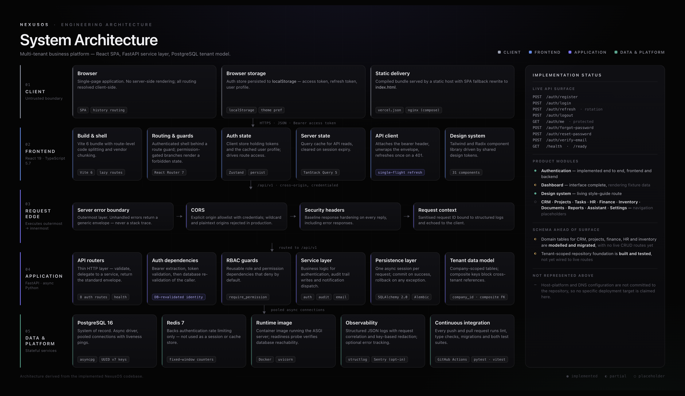
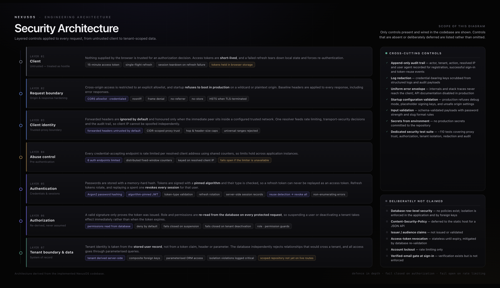
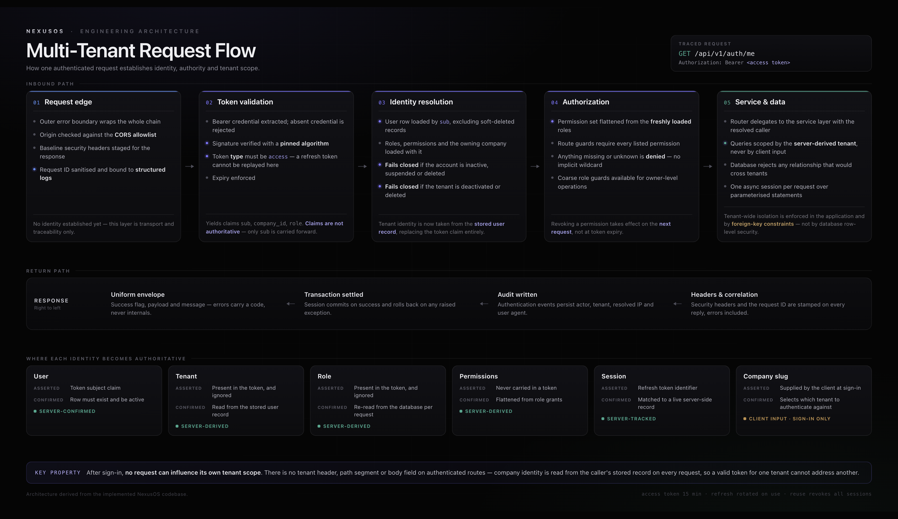
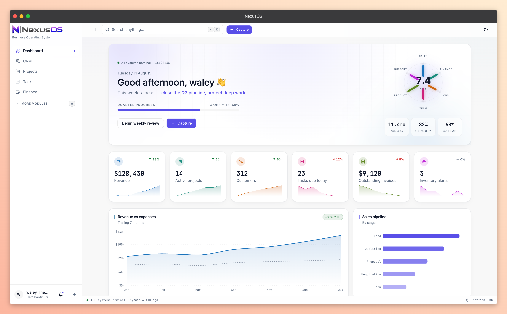
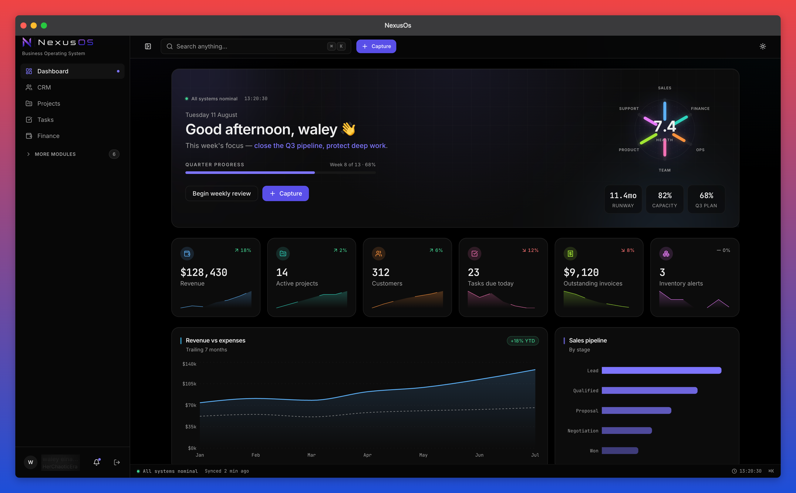
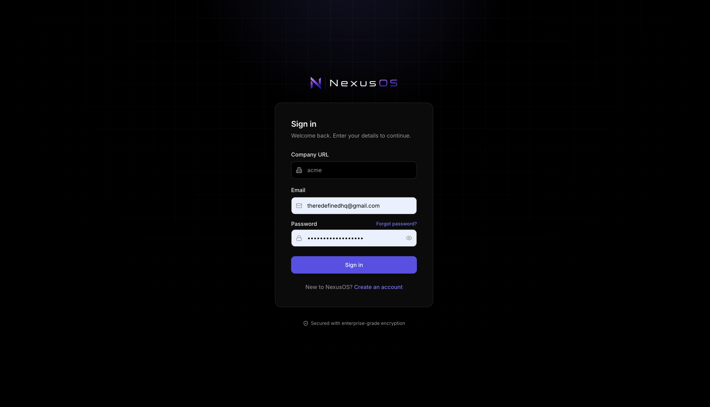
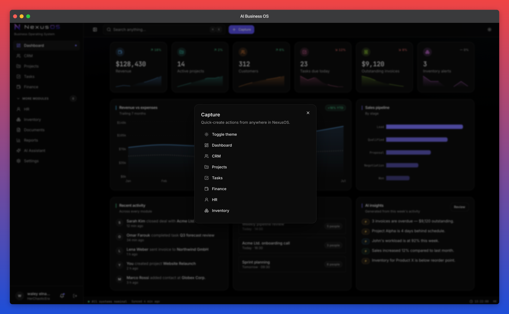

# NexusOS

A security-first, multi-tenant business operating platform built with React, TypeScript, FastAPI and PostgreSQL.

NexusOS is designed to host multiple business capabilities behind a single identity model, permission system and tenant boundary. Rather than shipping product modules first and retrofitting multi-tenancy later, the identity, authorization and isolation layers were built and tested first, so everything added on top inherits them. This repository currently contains that platform foundation, complete and tested, plus the application shell and design system the product modules will be assembled from.

---

## Overview

The goal is a unified platform capable of hosting CRM, projects, tasks, finance, HR, inventory, documents and reporting behind shared infrastructure: one identity model, one role and permission system, one tenant boundary, one design system.

The work completed so far is deliberately weighted toward that foundation. Authentication, authorization, tenant isolation, the security middleware layer and the frontend platform are implemented and covered by tests. Most business modules exist as database schema and navigation entries rather than working features, and the sections below are explicit about which is which.

Concretely: the live API surface is 8 `/auth/*` routes plus `/health` and `/ready`. No domain or CRUD endpoints exist yet.

---

## Engineering Approach

Building product modules first and adding multi-tenancy later is faster to a demo and structurally difficult to undo. Tenant scoping degrades into a filter that every query is individually responsible for remembering, and one forgotten condition becomes a cross-tenant data leak.

NexusOS inverts that order. Tenant identity is derived from server state rather than accepted from the request, authorization is re-read from the database rather than trusted from a token claim, and the component layer exists before the pages that consume it. A feature added later cannot opt out of these decisions, because they are enforced centrally rather than by convention.

The principles that follow from that:

- **Tenant identity is derived, not trusted.** Nothing in an authenticated request selects its own tenant.
- **Authorization is re-validated, not assumed.** A valid token proves issuance, not current authority.
- **Security controls fail closed** where a failure would otherwise grant access.
- **Shared infrastructure precedes product modules.** Identity, permissions and isolation are solved once, centrally.
- **UI primitives precede pages.** Tokens and components exist before the screens that consume them.
- **Documentation distinguishes implemented from planned.** Prepared schema and interface work is labelled as such.

---

## Current Status

### ✅ Implemented

**Platform and identity**
- Multi-tenant data model: companies, users, per-tenant roles, global permission catalogue, sessions, audit log
- Server-derived tenant identity — authenticated routes accept no tenant identifier from the client
- UUID v7 primary keys, soft delete, audit columns and tenant columns standardised across tables

**Authentication**
- Registration with tenant bootstrap (company, default roles, permission grants, owner user)
- Login, logout, password reset, email verification
- JWT access tokens with algorithm pinning and token-type validation
- Refresh tokens with server-side session records, rotation on use, and reuse detection
- Argon2 password hashing

**Authorization**
- Role-based access control with per-tenant roles and a global permission catalogue
- Role and permission evaluation re-read from the database on every authorization-sensitive request
- Deny-by-default route guards; fail-closed on suspended users and deactivated tenants

**Security**
- CORS allowlisting with production startup validation
- Security headers middleware
- Redis-backed rate limiting on authentication endpoints
- Trusted-proxy-aware client IP resolution
- Request context with correlation IDs and structured logging
- Append-only audit records for authentication events
- Credential redaction in logs
- Generic error responses with no internals exposed

**Frontend**
- React application shell with sidebar, top bar, status bar and command palette
- Route guards and permission-gated routes with lazy loading
- API client with bearer injection and single-flight token refresh
- Design system: design tokens, 31 components, light/dark/system themes
- Forms with schema validation; shared loading, empty and error states
- Dashboard interface with KPI, chart and activity widgets

**Quality**
- Automated test suites for backend and frontend, weighted toward security and tenant behaviour
- CI pipeline running lint, static type checking, migrations, schema drift check and both test suites

### ◐ Foundation / Prepared

- **Domain models** for CRM, projects and tasks, finance, HR, inventory, documents, notifications, activity and workflows — 38 model classes, modelled and migrated with tenant columns and cross-tenant constraints, with no API endpoints yet
- **Tenant-scoped repository foundation** — generic tenant filtering, mass-assignment protection, server-side pagination clamping and sort-field allowlisting; implemented and tested, with zero live callers
- **Dashboard data** — the interface is complete but served by a fixture module, not a live endpoint, pending an aggregate API
- **Email delivery** — token lifecycle and service boundary complete; no provider wired, delivery currently logs only

### ○ Planned

- CRM workflows (customers, contacts, leads, deals)
- Project and task workflows
- Finance workflows (invoicing, expenses, payments)
- HR workflows (employees, leave, attendance)
- Inventory workflows (products, warehouses, stock, suppliers)
- Document management and reporting
- AI capabilities — conversation and report tables are modelled; no inference code exists
- PostgreSQL row-level security as a second isolation layer

**There is no AI functionality in this repository.** `OPENAI_API_KEY` is a configuration field declaration with zero usage anywhere in application code. The dashboard's insights panel is a UI component rendering fixture data.

The screens for CRM, projects, tasks, HR, finance, inventory, documents, reports and settings are sidebar navigation placeholders backed by migrated schema. They are not working features.

---

## System Architecture

A single-page React client talks to a FastAPI service over a versioned REST API, with PostgreSQL as the system of record. Routers stay thin and delegate to services; identity is resolved by dependencies rather than by individual endpoints.



Redis is used solely for shared rate-limit counters. It is not a cache and not a session store.

Requests pass through middleware in a fixed order — server error boundary, CORS, security headers, request context — before reaching a router. Each request gets one database session, committed on success and rolled back on any raised exception. Every response, success or failure, uses the same envelope shape.

---

## Multi-Tenant Architecture

A company is the tenant. Users, roles and business records carry a company reference, and users are unique by email *within* a company rather than globally, so the same person can hold accounts in two tenants.

At sign-in the client supplies a company slug alongside credentials. This is the only point at which the client influences tenant selection, and it works the way a subdomain would — it selects which tenant to authenticate against and grants nothing on its own.

After authentication:

- **User identity** is resolved server-side. The token's subject claim is used only to locate the user row, which must exist and be active.
- **Tenant identity** is read from that stored user record. The access token also carries a company identifier; it is ignored.
- **Roles** are re-read from the database on every authorization-sensitive request, not taken from the token's role claim.
- **Permissions** are derived from database role grants and are never carried in a token.
- **Authenticated routes accept no client-provided tenant identifier** — there is no tenant header, path segment or body field.

The result is that a request cannot influence its own tenant scope, and a valid token for one tenant cannot address another.

### Isolation model

Current isolation is **application-level scoping plus relational constraints**:

- Tenant-aware queries are scoped by the server-derived company identifier, and the repository foundation raises rather than running an unscoped query when tenant context is missing.
- Child tables reference parents by composite foreign key — `(id, company_id)` — so the database rejects any row attaching a record in one tenant to a parent in another, independent of application correctness.

**PostgreSQL Row Level Security is not implemented.** No policies exist and no per-request session variable is set. RLS would make isolation independent of the application layer entirely and is listed under Planned; until it exists, it is not claimed.

---

## Authentication

```
Registration → Login → Access token → Refresh session → Rotation → Logout
```

**Registration** creates the company, seeds default roles and their permission grants, creates the owner user, issues a session and generates an email verification token.

**Login** identifies the user by company slug, email and active status, verifies the password and issues a token pair. Failures return one generic message regardless of which element was wrong, so the endpoint cannot be used to enumerate accounts.

**Access tokens** expire after 15 minutes. They are signed with a pinned algorithm, and decoding validates the declared token type, so a refresh token cannot be presented where an access token is expected.

**Refresh tokens** expire after 30 days and rotate on every use. The raw token is never stored — the server keeps a session record holding the token's unique identifier, expiry and revocation timestamp.

**Refresh-token reuse detection:** presenting a refresh token that has already been spent is treated as evidence of theft. Every session belonging to that user is revoked and an audit event is written, so a stolen token buys one use before locking out both parties and surfacing the compromise.

**Logout** revokes the presented session and is idempotent. **Password reset** consumes a single-use token stored as a hash and revokes all sessions for that user. Verification and reset tokens are opaque random values rather than JWTs, specifically so they can be invalidated server-side before expiry.

---

## Authorization / RBAC

Roles are per-tenant database rows, not an enum. Registration seeds five: **Owner**, **Admin**, **Manager**, **Employee** and **Viewer**, each granted permissions from a global catalogue of `module.action` strings. Wildcards are expanded once at grant time, so request-time checks are plain set operations with no pattern matching and no implicit matches.

Two authentication dependencies exist, and the split is deliberate:

| Dependency | Cost | Guarantee |
|---|---|---|
| Token validation only | No database access | The token is validly signed, unexpired and of the correct type. Its role claim may be stale. |
| Full identity resolution | One indexed query with eager-loaded relations | Role and permissions are current as of this request; fails closed if the user is missing, soft-deleted, inactive or suspended, or if their company is deactivated or deleted. |

Role and permission guards both build on the second, so every route guard inherits the fresh-from-database check. Permission checks require every listed permission and deny anything missing or unrecognised.

The reason token claims are not treated as authoritative is concrete: it closes the stale-privilege window. Suspending a user or revoking a permission takes effect on their next request rather than whenever their current access token happens to expire.

---

## Security Engineering

| Control | Implementation |
|---|---|
| Password hashing | Argon2 (memory-hard) via passlib |
| Authentication | JWT access tokens with algorithm pinning and token-type validation |
| Session management | Server-side session records, refresh rotation, reuse detection |
| Authorization | RBAC re-validated against database state per request, deny by default |
| Tenant identity | Derived from stored user record, never accepted from the request |
| Tenant isolation | Application-level scoping plus composite foreign key constraints |
| Rate limiting | Redis-backed counters on 6 authentication endpoints, keyed on resolved client IP |
| Client IP | Trusted-proxy-aware resolver; forwarded headers ignored unless the peer is in a configured network |
| Security headers | Applied by middleware to every response, including error responses |
| CORS | Explicit origin allowlist with credentials |
| Startup validation | Production refuses to start on debug mode, placeholder signing keys, or wildcard/plaintext origins |
| Audit trail | Append-only records with actor, tenant, action, resolved IP and user agent |
| Logging | Structured logs with request correlation and credential redaction |
| Error handling | Uniform envelope; generic messages with no internals or stack traces in responses |
| Data access | ORM parameter binding throughout; no dynamic SQL |
| Secrets | Loaded from environment with minimum key length enforced; none committed |

### Deliberately not claimed

Stating what is absent is part of the point:

- **PostgreSQL row-level security** — no policies exist and no per-request session variable is set; isolation is application-level and relational
- **Content-Security-Policy and Permissions-Policy** — not set; deferred to the static host for a JSON API
- **JWT issuer and audience claims** — not issued, not validated
- **Access-token revocation before expiry** — tokens are stateless for their 15-minute life; mitigated by per-request database re-validation
- **Account lockout after repeated failures** — rate limiting only
- **Mandatory verified-email login** — verification exists but is not required to authenticate
- **Fail-closed rate limiting** — the limiter fails open if Redis is unreachable, a deliberate availability trade-off

---

## Frontend Engineering

React 19 and TypeScript on Vite, with route-level code splitting.

- **Routing** — a declarative route table splitting a public authentication shell from an authenticated application shell behind a guard, with permission-gated branches rendering an explicit forbidden state
- **State** — session state in a small persisted store; server data in a query cache with its own staleness policy, cleared wholesale when a session ends
- **API client** — attaches the bearer header and unwraps the response envelope into typed data or a typed error
- **Token refresh** — a 401 triggers at most one retry per request, and concurrent 401s share a single in-flight refresh, so parallel requests cannot invalidate each other through rotation. A failed refresh clears auth state and the query cache, then redirects to sign-in
- **Design system** — design tokens defining a surface ladder, chart palette, radii, elevation and typography, mapped into Tailwind and consumed by components built on Radix primitives
- **Forms** — React Hook Form with Zod resolvers, so validation is declared once and shared between form and typed payload
- **System states** — loading skeletons, empty states, error states with recovery actions, offline detection and toasts as shared components
- **Themes** — light, dark and system, persisted locally

The authentication screens run against the live API. The dashboard is interface-complete but renders fixture data.

---

## Technology Stack

| Layer | Technology |
|---|---|
| Frontend | React 19, TypeScript, Vite |
| Routing & state | React Router, TanStack Query, Zustand |
| UI | Tailwind CSS, Radix UI, Recharts, Framer Motion |
| Backend | FastAPI, Python 3.12 |
| Database | PostgreSQL 16 |
| ORM | SQLAlchemy 2.0 (async, asyncpg) |
| Migrations | Alembic |
| Shared counters | Redis 7 |
| Validation | Zod (frontend), Pydantic v2 (backend) |
| Auth | passlib with Argon2, PyJWT |
| Logging | structlog |
| Testing | pytest, Vitest, Testing Library |
| Linting & types | ruff, mypy, ESLint, TypeScript |
| Containers | Docker, Docker Compose, nginx |
| CI | GitHub Actions (Python 3.12, Node 22) |

---

## Testing & Reliability

**Backend** — pytest, running against live PostgreSQL and Redis services in CI rather than mocks. 167 test functions across 20 files, of which 111 sit in a dedicated security suite:

- **Authorization** — permissions hydrated from the database rather than the token; suspended, deactivated and soft-deleted users fail closed; deactivated and deleted companies fail closed for their members; deny-by-default; a stale token role losing to the current database role
- **Tenant isolation** — cross-tenant reads return not found; querying a tenant model with no company set fails closed; cross-tenant update, restore, delete, count, exists and bulk-fetch all rejected; pagination clamping and sort-field allowlisting
- **Cross-tenant relationships** — the database rejects records referencing another tenant's parent row
- **Trusted proxy** — IP and scheme resolution, spoof resistance, CIDR validation, and end-to-end behaviour through the real ASGI application
- **Plus** request-ID handling, log redaction, exception logging, email-log safety, session expiry, mass-assignment rejection and rate limiting

**Frontend** — Vitest with Testing Library. 89 test cases across 21 files, covering authentication pages, the auth service and validation schemas, and UI primitives.

Coverage is deliberately weighted toward security and tenant behaviour. The dashboard interface and application shell are not meaningfully covered.

**CI** runs on every push and pull request: backend lint, static type checking, migrations, a schema drift check, permission seeding and pytest; then frontend type checking, tests and a production build. Running migrations before tests means a model that has drifted from its migration history fails the build rather than a deployment.

---

## Repository Structure

The application lives two levels below the repository root. All development commands run from the application directory.

```
.
├── ai-business-os/
│   └── ai-business-os/          # Application root — run commands from here
│       ├── backend/
│       │   ├── app/
│       │   │   ├── api/v1/          # Routers — auth and health only
│       │   │   ├── core/            # Config, security, logging, rate limiting, client IP
│       │   │   ├── db/              # Async session, permission catalogue seed
│       │   │   ├── dependencies/    # Identity resolution and RBAC guards
│       │   │   ├── middleware/      # Request context, security headers
│       │   │   ├── models/          # SQLAlchemy models
│       │   │   ├── repositories/    # Tenant-scoped repository foundation
│       │   │   ├── schemas/         # Pydantic request/response models
│       │   │   └── services/        # Business logic
│       │   ├── migrations/          # Alembic revisions
│       │   └── tests/
│       │       └── security/        # Security and tenant-isolation suites
│       ├── frontend/
│       │   └── src/
│       │       ├── api/             # HTTP client and interceptors
│       │       ├── components/ui/   # Design system components
│       │       ├── features/        # Feature modules
│       │       ├── layouts/         # Application and auth shells
│       │       ├── pages/           # Route-level components
│       │       ├── routes/          # Route table and guards
│       │       ├── stores/          # Session and UI state
│       │       └── styles/          # Design tokens
│       ├── docs/                    # Engineering and product notes
│       ├── .github/workflows/       # CI pipeline
│       ├── .env.example
│       ├── docker-compose.yml
│       └── Makefile
│
├── docs/
│   ├── architecture/            # Architecture diagrams
│   └── screenshots/             # Product screenshots
└── SECURITY.md
```

---

## Running Locally

**Requirements:** Docker and Docker Compose for the full stack, or Python 3.12, Node 22, PostgreSQL 16 and Redis 7 to run services individually.

All commands below assume you have first moved into the application directory:

```bash
cd ai-business-os/ai-business-os
```

### Full stack with Docker

```bash
cd ai-business-os/ai-business-os
cp .env.example .env      # then set SECRET_KEY and review the values
make dev                  # docker compose up --build
```

This starts PostgreSQL, Redis, the API and the built frontend. Services listen on:

| Service | Port |
|---|---|
| Frontend (nginx) | 3000 |
| API | 8000 |
| PostgreSQL | 5432 |
| Redis | 6379 |

The Compose file provisions a throwaway local database with its own credentials. Use your own values in `.env`; nothing there is intended for any environment other than a local machine.

### Running services individually

Start PostgreSQL and Redis first — either from the Compose file or from a local installation — then point `DATABASE_URL` and `REDIS_URL` at them.

**Backend**

```bash
cd ai-business-os/ai-business-os/backend
pip install -r requirements.txt
alembic upgrade head          # or, from the application directory: make migrate
python -m app.db.seed         # seed the permission catalogue
uvicorn app.main:app --reload # or, from the application directory: make api
```

The API serves on port 8000. Interactive API documentation is available at `/docs` outside production.

**Frontend**

```bash
cd ai-business-os/ai-business-os/frontend
npm install
npm run dev                   # or, from the application directory: make web
```

The Vite dev server runs on port 5173 and proxies `/api` to the backend on port 8000, so no additional configuration is needed for local development.

### Common commands

Run these from `ai-business-os/ai-business-os`:

```bash
make dev        # full stack via Docker — docker compose up --build
make api        # backend only — cd backend && uvicorn app.main:app --reload
make web        # frontend only — cd frontend && npm run dev
make migrate    # apply migrations — alembic upgrade head
make revision m="description"   # generate a migration
make test       # backend tests — pytest -q
make lint       # backend ruff + frontend type check
```

```bash
cd ai-business-os/ai-business-os/frontend && npm test          # frontend tests
cd ai-business-os/ai-business-os/frontend && npm run build     # production build
cd ai-business-os/ai-business-os/backend && mypy app           # backend type check
```

### Environment configuration

Copy `.env.example` to `.env` in the application directory and fill in values locally. Never commit `.env`. Only variable names are listed here.

**Backend**

| Variable | Purpose |
|---|---|
| `ENVIRONMENT` | `development`, `staging` or `production` |
| `DEBUG` | Debug mode; rejected at startup in production |
| `SECRET_KEY` | JWT signing key; minimum length enforced, placeholders rejected in production |
| `DATABASE_URL` | PostgreSQL connection string |
| `REDIS_URL` | Redis connection string for rate-limit counters |
| `CORS_ORIGINS` | JSON array of allowed origins; wildcards and plaintext HTTP rejected in production |
| `FRONTEND_URL` | Base URL used to build verification and password-reset links |
| `RATE_LIMIT_ENABLED` / `RATE_LIMIT_PER_MINUTE` | Rate limiter toggle and default budget |
| `HSTS_ENABLED` | Emit HSTS when TLS terminates upstream |
| `TRUSTED_PROXY_MODE` / `TRUSTED_PROXY_NETWORKS` | Whether and from which networks forwarded headers are trusted |
| `ACCESS_TOKEN_EXPIRE_MINUTES` / `REFRESH_TOKEN_EXPIRE_DAYS` | Token lifetimes |
| `SENTRY_DSN` | Optional error tracking |
| `RESEND_API_KEY` / `EMAIL_FROM` | Reserved for email delivery; provider not yet wired |
| `OPENAI_API_KEY` | Reserved; declared in configuration only, no inference code exists |

**Frontend** — copy `frontend/.env.example` to `frontend/.env` if you need to override the default:

| Variable | Purpose |
|---|---|
| `VITE_API_BASE_URL` | API base path; defaults to `/api/v1` through the Vite dev proxy |

Generate a signing key with:

```bash
python -c "import secrets; print(secrets.token_urlsafe(48))"
```

---

## Architecture Artifacts

Three diagrams document the system as implemented.

**System Architecture** — component map across client, frontend, request edge, application and data tiers.



**Security Architecture** — the layered controls a request passes through, including an explicit list of controls not implemented.



**Multi-Tenant Request Flow** — one authenticated request traced end to end, showing where each identity becomes authoritative.



---

## Screenshots

The authentication screens run against the live API. The dashboard is interface-complete but renders fixture data rather than a live endpoint.

**Dashboard — light**



**Dashboard — dark**



**Sign-in**



**Command palette**



---

## Roadmap

- [x] Platform foundation and multi-tenant data model
- [x] Authentication lifecycle with refresh rotation and reuse detection
- [x] RBAC with database-revalidated authorization
- [x] Security middleware layer
- [x] Frontend application shell and design system
- [x] Test suites and CI pipeline
- [ ] Dashboard aggregate endpoint replacing fixture data
- [ ] CRM workflows
- [ ] Projects and tasks
- [ ] Finance
- [ ] HR
- [ ] Inventory
- [ ] Documents and reporting
- [ ] AI capabilities
- [ ] PostgreSQL row-level security as a second isolation layer

---

## Project Status

NexusOS is an actively developed portfolio and engineering project. The platform foundation — authentication, authorization, tenant isolation, security middleware and the frontend system — is implemented and tested. Several business modules represented in the database schema and in the navigation are still under development and are labelled accordingly throughout this document.

It is not deployed as a commercial product and has no users or customers.

---

## Author

**Waley El-Nagdi** — [@waley7337](https://github.com/waley7337)

Sole engineer: system architecture, backend, frontend, database design, security engineering, design system, testing and build pipeline.

---

## License

No license is currently specified. All rights reserved.
