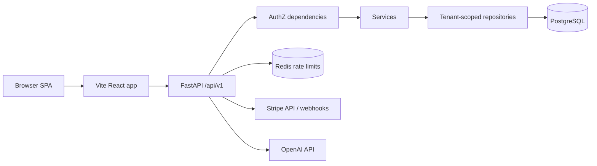

# NexusOS

Multi-tenant business operations platform: shared identity, RBAC, and tenant isolation under one API and React application shell, with implemented CRM, HR, finance, inventory, projects/tasks, reporting, notifications, dashboard metrics, AI assistant, and Stripe billing/Connect integrations.

**Accuracy note:** This README reflects the repository state audited against source on `main` (application root `ai-business-os/ai-business-os/`). It does **not** claim that every module is production-hardened or independently security-audited. See [docs/IMPLEMENTATION_STATUS.md](docs/IMPLEMENTATION_STATUS.md) for evidence-based status categories.

---

## Table of contents

1. [What it is](#what-it-is)
2. [Users and tenancy model](#users-and-tenancy-model)
3. [Technology stack](#technology-stack)
4. [Repository layout](#repository-layout)
5. [Architecture (summary)](#architecture-summary)
6. [Module status (summary)](#module-status-summary)
7. [Security controls (summary)](#security-controls-summary)
8. [Cloudflare (external edge)](#cloudflare-external-edge)
9. [Local development](#local-development)
10. [Environment configuration](#environment-configuration)
11. [Tests and CI](#tests-and-ci)
12. [Database migrations](#database-migrations)
13. [Deployment](#deployment)
14. [Known limitations](#known-limitations)
15. [Further documentation](#further-documentation)

---

## What it is

NexusOS is a **SaaS-style business OS** for small and mid-size teams: customers, deals, invoices, expenses, employees, leave/attendance, inventory, projects/tasks, operational reports, in-app notifications, and an AI assistant that can call tenant-scoped tools.

It is built so that **tenant identity, authentication, and permission checks are central** (FastAPI dependencies + tenant-scoped repositories), rather than bolted on after product screens exist.

---

## Users and tenancy model

| Concept | Meaning in code |
|--------|------------------|
| **Tenant** | A `Company` row |
| **User** | Belongs to exactly one company (`users.company_id`) |
| **Login selection** | Client supplies **company slug + email + password** at login/register; after auth, APIs do **not** accept a client-chosen tenant id |
| **Roles / permissions** | Per-tenant roles; global permission catalogue; grants seeded at registration |

Isolation is **application-enforced** (server-derived `company_id` + `BaseRepository` filters + composite FKs). **PostgreSQL RLS is not implemented** (deliberately deferred). Details: [docs/MULTI_TENANCY.md](docs/MULTI_TENANCY.md).

---

## Technology stack

| Layer | Technologies (from manifests / code) |
|-------|--------------------------------------|
| Frontend | React 19, TypeScript, Vite 6, React Router 7, TanStack Query 5, React Hook Form, Tailwind (v4 migration on `main`), Stripe.js / React Stripe |
| Backend | FastAPI 0.115.x, Pydantic v2, SQLAlchemy 2.0 async, Alembic, Argon2, PyJWT, Redis 5.x client, Stripe Python SDK 11.x |
| Data | PostgreSQL (asyncpg), Redis (rate-limit counters) |
| AI | OpenAI API via configurable `OPENAI_API_KEY` / `OPENAI_MODEL` (fail-soft when unset) |
| Payments | Stripe Checkout (hosted + Elements), Stripe Connect onboarding (Accounts v2 path in code), signature-verified webhooks |
| CI | GitHub Actions [`.github/workflows/ci.yml`](.github/workflows/ci.yml) |

---

## Repository layout

```
NexusOS/                              # Git root
├── README.md                         # This file
├── SECURITY.md                       # Vulnerability reporting policy
├── docs/                             # Portfolio / architecture docs (this pass)
├── .github/workflows/ci.yml          # Active CI (paths into nested app)
└── ai-business-os/ai-business-os/    # **Application root**
    ├── backend/                      # FastAPI app, migrations, tests
    ├── frontend/                     # Vite React SPA
    ├── docs/                         # Engineering reports, product/ops notes
    └── nginx/                        # Optional local/proxy samples
```

All install, migrate, and test commands below use the nested application paths.

---

## Architecture (summary)



Typical authenticated request:

1. SPA sends `Authorization: Bearer <access_jwt>`.
2. Middleware: CORS, security headers, request context / correlation id.
3. `get_current_user` validates JWT; `get_current_active_user` **reloads user, company, roles, and permissions from PostgreSQL** and sets `company_id` from the DB row (not from a client body field).
4. `require_permission(...)` / role guards deny by default when grants are missing.
5. Handlers use repositories constructed with that `company_id`; queries add `WHERE company_id = …` for tenant models.
6. Domain errors map to a uniform JSON envelope `{ success, data, message, errors }`.

Full detail: [docs/ARCHITECTURE.md](docs/ARCHITECTURE.md).

---

## Module status (summary)

Statuses are defined in [docs/IMPLEMENTATION_STATUS.md](docs/IMPLEMENTATION_STATUS.md). Summary:

| Area | Status (evidence-based) |
|------|-------------------------|
| Auth (register/login/refresh/logout/verify/reset) | **Implemented** — APIs + tests |
| RBAC / permissions | **Implemented** — DB re-validation on guarded routes |
| CRM (customers, contacts, leads, deals, notes) | **Implemented** — APIs + FE pages + tests |
| HR (employees, leave, attendance) | **Implemented** — APIs + FE + tests |
| Finance (invoices, payments, expenses) | **Implemented** — APIs + FE + tests |
| Inventory (products, warehouses, stock) | **Implemented** — APIs + FE |
| Projects & tasks | **Implemented** — APIs + FE |
| Reports / dashboard metrics / notifications | **Implemented** — APIs + FE (coverage varies) |
| Settings (company profile, billing/Connect UI) | **Implemented** — APIs + FE |
| AI assistant | **Implemented, partially verified** — code + tools; needs live `OPENAI_API_KEY` |
| Platform billing (SaaS subscription) | **Implemented, partially verified** — Elements/hosted checkout; env-gated |
| Tenant invoice payments (Stripe Connect) | **Implemented, partially verified** — Connect onboarding + webhooks; env-gated |
| PostgreSQL RLS | **Planned** — explicitly deferred |
| Documents module | **Unverified / not a first-class module** in current routers |

> The previous root README claim that the live API was “only `/auth/*` + health” and that CRM/finance/HR were “placeholders only” is **obsolete** relative to `app/api/v1/router.py` and the feature routers under `app/api/v1/`.

---

## Security controls (summary)

| Control | Implementation (high level) |
|---------|-----------------------------|
| Passwords | Argon2 (`argon2-cffi`) |
| Tokens | JWT access + rotating refresh sessions; type-pinned decode |
| AuthZ | `require_permission` / `require_roles` on `get_current_active_user` |
| Tenant scope | Server-derived `company_id` + repository filters; composite FKs |
| Rate limits | Redis-backed on selected auth routes; **fails open** if Redis errors |
| Headers | `SecurityHeadersMiddleware` (HSTS when HTTPS identity or `HSTS_ENABLED`) |
| Stripe | Signature verification on webhooks; billing/Connect **fail-closed** until flags + secrets |
| Logging | Structured logging; credential redaction patterns in security tests |

Details and residual risks: [docs/SECURITY.md](docs/SECURITY.md).  
Vulnerability reports: [SECURITY.md](SECURITY.md).

---

## Cloudflare (external edge)

Cloudflare is **not configured inside this repository** (no Wrangler/Terraform Cloudflare resources checked in). For a public deployment that places DNS/TLS in front of the origin, Cloudflare (or another CDN/WAF) can act as an **external edge**: DNS, TLS termination, and optional WAF/DDoS/bot controls.

**From repository evidence alone:** specific Cloudflare WAF rules, edge rate limits, and bot settings are **unverified**. Do not assume they are enabled.

Cloudflare (when used) **complements** application controls; it does **not** replace JWT auth, RBAC, tenant filters, input validation, or Stripe webhook verification.

See [docs/SECURITY.md](docs/SECURITY.md#cloudflare-external-edge) and [docs/ARCHITECTURE.md](docs/ARCHITECTURE.md#external-edge-cloudflare).

---

## Local development

### Prerequisites

- Python **3.12+** (CI uses 3.12)
- Node.js **22+** (CI uses 22)
- PostgreSQL 16+ and Redis 7+ (local or Docker)

### Backend

```bash
cd ai-business-os/ai-business-os/backend
python -m venv .venv
source .venv/bin/activate   # Windows: .venv\Scripts\activate
pip install -r requirements.txt
cp ../.env.example ../.env  # or copy into backend per your layout; see template
# Set DATABASE_URL, REDIS_URL, SECRET_KEY (32+ chars) in your local env file
alembic upgrade head
python -m app.db.seed
uvicorn app.main:app --reload --port 8000
```

API docs (when `DEBUG`/docs enabled per config): `http://localhost:8000/docs`

### Frontend

```bash
cd ai-business-os/ai-business-os/frontend
cp .env.example .env.local   # set VITE_API_BASE_URL / equivalent per example
npm ci
npm run dev
```

Default Vite port is typically `5173` (see frontend config).

---

## Environment configuration

Use the templates (placeholders only — never commit real secrets):

- [`ai-business-os/ai-business-os/.env.example`](ai-business-os/ai-business-os/.env.example)
- [`ai-business-os/ai-business-os/frontend/.env.example`](ai-business-os/ai-business-os/frontend/.env.example)

Important backend variable **names** (non-exhaustive):

| Name | Role |
|------|------|
| `SECRET_KEY` | JWT / crypto material |
| `DATABASE_URL` | Async SQLAlchemy URL (`postgresql+asyncpg://…`) |
| `REDIS_URL` | Rate limiting |
| `CORS_ORIGINS` | JSON array of allowed origins |
| `FRONTEND_URL` | Links for verify/reset and Stripe return URLs |
| `HSTS_ENABLED` / `TRUSTED_PROXY_*` | TLS / proxy identity (see security docs) |
| `OPENAI_API_KEY` | AI assistant (optional) |
| `STRIPE_PLATFORM_*`, `STRIPE_*_ENABLED`, `STRIPE_PRICE_*` | Billing / Connect (fail-closed when disabled) |

Root `.gitignore` ignores `.env*` and `.vercel/` at the repo root; nested app `.gitignore` files also ignore env files under `ai-business-os/`.

---

## Tests and CI

### Backend (from `ai-business-os/ai-business-os/backend`)

```bash
# Full suite (local; may include baseline failures outside CI’s scoped gate)
pytest -q

# CI-scoped gate (matches .github/workflows/ci.yml)
pytest -q tests/security/ tests/test_tenant_isolation.py \
  tests/test_invoice_payment_summary_resilience.py \
  tests/test_invoice_schema_columns.py \
  tests/test_reports_enum_sql.py \
  tests/test_unhandled_cors_headers.py

ruff check app --ignore F401,F541,F841
```

### Frontend (from `ai-business-os/ai-business-os/frontend`)

```bash
npm run typecheck
npm test
npm run lint
npm run build
```

### CI

[`.github/workflows/ci.yml`](.github/workflows/ci.yml) runs on `push` to `main` and pull requests:

- Backend: ruff (selected ignores), `alembic upgrade head`, seed, **scoped** pytest (security + selected regressions)
- Frontend: `npm ci`, typecheck, test, build

**Note:** CI intentionally does **not** run the entire backend pytest suite as a merge gate (documented baseline debt in the workflow comments).

---

## Database migrations

- Tool: **Alembic** under `ai-business-os/ai-business-os/backend/migrations`
- Apply: `alembic upgrade head`
- Seed permissions catalogue: `python -m app.db.seed`

Do not invent migration names here; use `alembic history` / `alembic current` locally against your database.

---

## Deployment

Documented **intent** from ops notes and production hostnames used in prior operations (treat live infra as **externally configured**):

| Component | Typical host | Evidence in repo |
|-----------|--------------|------------------|
| Frontend SPA | Vercel project linked under `.vercel/` (local only; not committed) | Frontend Vite app; ops docs |
| Backend API | Railway (or similar) running FastAPI | Ops roadmap docs; no IaC in-repo |
| PostgreSQL / Redis | Managed services attached to backend | Env templates |
| Stripe | External SaaS | `stripe` SDK + webhook routes |

Distinguish carefully:

- **In repository:** application code, migrations, CI, env **templates**, engineering docs.
- **Outside repository / unverified here:** live Railway/Vercel variable values, Cloudflare dashboard toggles, production HSTS/proxy CIDRs.

Ops notes (historical / operational detail): [`ai-business-os/ai-business-os/docs/ops/`](ai-business-os/ai-business-os/docs/ops/).

---

## Known limitations

- **No PostgreSQL RLS** — isolation is application-level + FK constraints ([RLS decision note](ai-business-os/ai-business-os/docs/reports/Part-03.1/RLS-Decision-Note.md); note that some historical paragraphs in that file predate CRM repository adoption — see MULTI_TENANCY.md).
- **Rate limiting fails open** if Redis raises errors (`app/core/rate_limit.py`).
- **Stripe and AI** are env-gated; without keys/flags they stay unavailable (fail-closed / fail-soft respectively).
- **CI scopes** backend tests; full-suite green is not guaranteed by the merge gate alone.
- **Trusted-proxy / HSTS production settings** are configuration-dependent and must be verified in the live environment.
- Some engineering reports under `ai-business-os/ai-business-os/docs/reports/` are **point-in-time** and may contradict current code if not updated.

---

## Further documentation

| Document | Purpose |
|----------|---------|
| [docs/ARCHITECTURE.md](docs/ARCHITECTURE.md) | End-to-end system architecture |
| [docs/MULTI_TENANCY.md](docs/MULTI_TENANCY.md) | Tenant isolation design and verification |
| [docs/SECURITY.md](docs/SECURITY.md) | Security architecture and residual risks |
| [docs/IMPLEMENTATION_STATUS.md](docs/IMPLEMENTATION_STATUS.md) | Module-by-module evidence-based status |
| [docs/NEXUSOS_MASTER_AUDIT.md](docs/NEXUSOS_MASTER_AUDIT.md) | Master audit (portfolio source of truth) |
| [docs/PORTFOLIO_UPDATE_PACKAGE.md](docs/PORTFOLIO_UPDATE_PACKAGE.md) | Portfolio text & diagram update package |
| [docs/README.md](docs/README.md) | Documentation index |
| [ai-business-os/ai-business-os/docs/](ai-business-os/ai-business-os/docs/) | Engineering reports, product/ops archives |

---

## License / contributing

See repository license and contribution conventions if present. For security vulnerabilities, follow [SECURITY.md](SECURITY.md) (private disclosure).
