# NexusOS — Database Architecture (Part 3)

PostgreSQL 16+ · SQLAlchemy 2.0 (async) · Alembic · 37 tables · 200+ indexes

## Global standards

Every tenant business table carries the same column set via `TenantBusinessMixin`:

```
id UUID v7 · company_id · created_at · updated_at · created_by · updated_by · deleted_at · is_active
```

Design decisions worth knowing:

**UUID v7 primary keys.** Time-ordered (48-bit ms timestamp prefix), so inserts append to the right edge of the B-tree instead of splattering random pages. At tens of millions of rows this is the difference between healthy and bloated indexes. Generated in `app/utils/uuid7.py` — no extra dependency.

**Denormalized `company_id` on child tables.** `contacts`, `invoice_items`, `task_comments` etc. are reachable through a parent, but they still carry `company_id`. Tenant isolation must never depend on a join being written correctly — the repository filters every table directly.

**Soft deletes everywhere, except append-only tables.** `audit_logs`, `activities`, `ai_messages`, `notifications` are history — they get no `deleted_at`, no `updated_by`, no `is_active`. History is immutable by design.

**Statuses are VARCHAR check-style enums** (`native_enum=False`). Adding a status is a code deploy, not a table-locking `ALTER TYPE`.

**Money is `NUMERIC(14,2)`.** Never float.

**Deterministic constraint names** via metadata naming conventions → clean, reviewable Alembic diffs forever.

## ON DELETE policy

| Relationship | Rule | Why |
|---|---|---|
| company → everything | CASCADE | Deleting a tenant removes the tenant |
| customer → contacts/leads/notes/meetings | CASCADE | Children have no meaning without the parent |
| customer → invoices | RESTRICT | Financial records must never vanish silently |
| invoice → payments | RESTRICT | Same — money history is protected |
| supplier → purchase_orders | RESTRICT | Same |
| user → owned records (`owner_id`, `created_by`, …) | SET NULL | Removing a person must not destroy business data |
| user → employees (`user_id`, Part 07.1) | SET NULL | Employment history survives user deletion; link may be cleared |

**HR identity (Part 07.1):** `Employee` is the employment record. `user_id` is **optional** — HR-only staff have no login. Identity for HR-only rows lives on `employees.first_name` / `last_name` / `work_email`. When linked, display names may be resolved from `users` if employee name columns are empty. **`employees.department` is HR-authoritative**; `users.department` remains but is not used by HR v1.

## Per-tenant uniqueness

- `users`: (`company_id`, `email`) — the same person can belong to two tenants
- `products`: (`company_id`, `sku`)
- `invoices`: (`company_id`, `invoice_number`)
- `roles`: (`company_id`, `name`) · `employees`: (`company_id`, `employee_number`)
- `attendance`: (`employee_id`, `date`) · `inventory`: (`warehouse_id`, `product_id`)
- `companies.slug`: globally unique (it's the tenant URL)

## Composite indexes (the hot paths)

Every list screen filters by tenant first, so indexes lead with `company_id`:
`(company_id, status)` on customers/projects/tasks/invoices/deals/leads/payments/employees,
`(company_id, created_at)` on customers/activities/audit_logs,
`(company_id, due_date)` on tasks/invoices, `(company_id, assignee_id)` on tasks,
`(user_id, is_read, created_at)` on notifications — the "unread badge" query.

## RBAC model

```
permissions (GLOBAL catalog, seeded)     roles (PER-COMPANY, customizable)
   "customers.read"                         Owner / Admin / Manager /
   "employees.read"       ←──────────→      Employee / Viewer (is_system)
   "finance.view"          role_permissions
        catalog seeded             │
                              user_roles ──→ users
```

Permissions are `<module>.<action>` strings seeded by `python -m app.db.seed` (idempotent). Roles belong to a company so each tenant can customize; the five defaults are flagged `is_system`.

**Employees module (Part 07.1, seven permissions):** `employees.read`, `employees.read_compensation`, `employees.read_self`, `employees.read_team`, `employees.create`, `employees.update`, `employees.delete`. Compensation (`salary_grade`) is never included in ordinary `employees.read` responses. Default Manager grants: `read_team` + `read_self` only (no `read_compensation`).

## Entity map

```mermaid
erDiagram
    companies ||--o{ users : has
    companies ||--o{ roles : has
    roles }o--o{ permissions : role_permissions
    users }o--o{ roles : user_roles

    companies ||--o{ customers : has
    customers ||--o{ contacts : has
    customers ||--o{ leads : has
    leads ||--o| deals : becomes
    customers ||--o{ meetings : has
    customers ||--o{ customer_notes : has
    customers ||--o{ invoices : billed

    companies ||--o{ projects : has
    projects ||--o{ tasks : contains
    tasks ||--o{ task_comments : has
    tasks ||--o{ task_attachments : has

    users ||--o| employees : "optional link"
    employees ||--o{ leave_requests : requests
    employees ||--o{ attendance : logs

    invoices ||--o{ invoice_items : contains
    invoices ||--o{ payments : receives

    companies ||--o{ products : owns
    companies ||--o{ warehouses : owns
    warehouses ||--o{ inventory : stocks
    products ||--o{ inventory : stocked
    companies ||--o{ suppliers : uses
    suppliers ||--o{ purchase_orders : fulfills

    companies ||--o{ documents : stores
    users ||--o{ notifications : receives
    companies ||--o{ audit_logs : records
    companies ||--o{ activities : records
    users ||--o{ ai_conversations : starts
    ai_conversations ||--o{ ai_messages : contains
    companies ||--o{ workflows : defines
    workflows ||--o{ workflow_steps : ordered
```



## Verified guarantees (tests/test_tenant_isolation.py)

Run against live PostgreSQL in CI on every push:

1. Company A's repository never returns company B's rows
2. Fetching B's row through A's scope → `NotFoundError` (never data, never a hint)
3. Querying a tenant table without tenant context fails closed (`TenantIsolationError`, CRITICAL log)
4. Same email can exist in two companies; duplicated within one company → `IntegrityError`
5. Soft-deleted rows disappear from all queries but remain in the table

## Working with the schema

```bash
make revision m="add loyalty points"   # autogenerate a migration
make migrate                           # apply to the database
python -m app.db.seed                  # (re)seed the permission catalog
```
