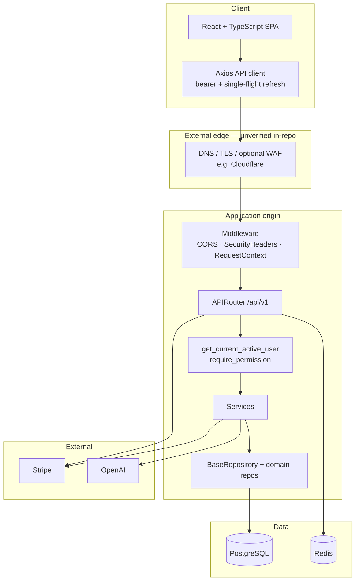
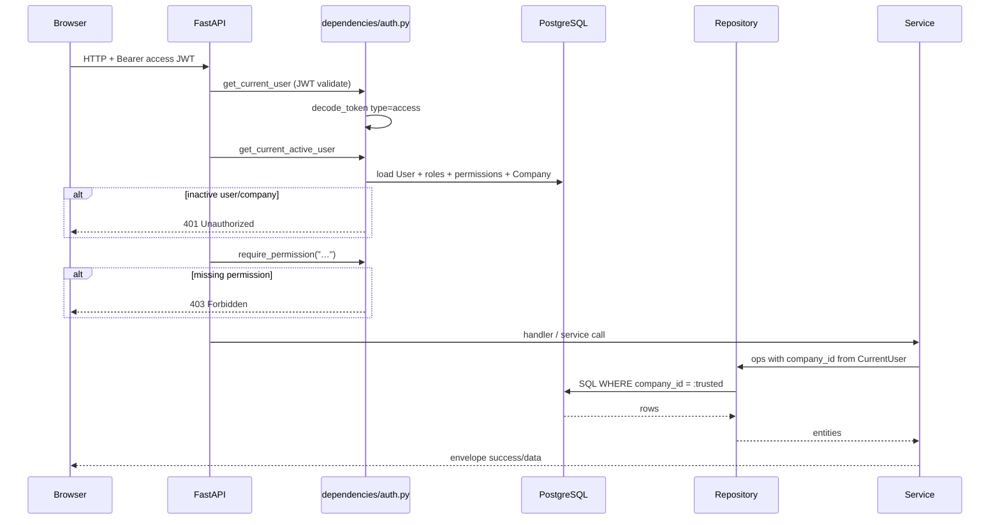

# NexusOS system architecture

**Scope:** Architecture as implemented under `ai-business-os/ai-business-os/` on `main`.  
**Non-goals:** Claiming production dashboard settings (Cloudflare WAF toggles, Railway variable values) that are not in this repository.

---

## 1. High-level components

| Component | Location | Responsibility |
|-----------|----------|----------------|
| React SPA | `frontend/` | Auth UI, module pages, permission-aware routing, API client |
| FastAPI app | `backend/app/main.py` | Middleware stack, router mount, exception handlers |
| API v1 | `backend/app/api/v1/` | HTTP endpoints by domain |
| Dependencies | `backend/app/dependencies/` | AuthN/AuthZ, DB session injection helpers |
| Services | `backend/app/services/` | Business logic (auth, AI, payments, …) |
| Repositories | `backend/app/repositories/` | Tenant-scoped data access (`BaseRepository` subclasses) |
| Models | `backend/app/models/` | SQLAlchemy ORM models |
| Migrations | `backend/migrations/` | Alembic schema history |
| PostgreSQL | External | System of record |
| Redis | External | Rate-limit counters only (not session store) |
| Stripe | External | Platform billing + Connect + webhooks |
| OpenAI | External | Assistant completions / tool calling |

---

## 2. Architecture diagram

---

## 3. FastAPI application lifecycle

Entry: `app.main:app`.

Observed middleware registration (order matters; see `app/main.py`):

1. Server error boundary / exception handling path for uniform envelopes  
2. CORS middleware (origins from settings; production validation exists in config)  
3. `SecurityHeadersMiddleware`  
4. Request context / correlation identifiers  

Routers are aggregated in `app/api/v1/router.py`:

- `/health` (and readiness patterns in health module)
- `/auth/*`
- `/crm/*` (via CRM router)
- `/hr/*`
- `/finance/*` (invoices, payments, expenses, checkout, payment-providers)
- `/inventory/*`
- `/projects/*` (projects + tasks)
- `/settings`
- `/reports`
- `/assistant`
- `/dashboard`
- `/notifications`
- `/billing`
- `/webhooks/stripe/*` (unauthenticated; signature-verified)

---

## 4. Authenticated request lifecycle

### Layer responsibilities

| Layer | Does | Does not |
|-------|------|----------|
| JWT decode | Prove signature, expiry, token type | Prove current role/permissions |
| `get_current_active_user` | Load live user/tenant/permissions | Trust token `role` for AuthZ |
| `require_permission` | Deny if any required grant missing | OR across unrelated permission sets (AND only) |
| Repository | Force `company_id` filter / assignment for tenant models | Replace DB RLS |
| Service | Domain rules, Stripe/AI orchestration | Parse client tenant ids for scoping |
| Webhooks | Verify Stripe signatures; map events | Use end-user JWT |

**Important:** Not every route uses identical controls. Health and Stripe webhooks are intentionally unauthenticated. Auth routes use rate limits and different entry rules. Always check the specific router module.

---

## 5. Data access and sessions

- Async SQLAlchemy session via `app/db/session.py` (`get_db` dependency).
- Tenant models use mixins (company id, soft delete, audit columns — see models).
- `BaseRepository` (`app/repositories/base.py`):
  - Requires `company_id` for `TenantMixin` models (fail-closed).
  - Clamps pagination and allowlists sort fields.
  - Protects mass-assignment of privileged columns.

CRM, HR, finance, inventory, and projects repositories subclass `BaseRepository`. Auth bootstrap paths use direct SQLAlchemy queries by design (tenant not yet established).

---

## 6. Redis

- Used by `app/core/rate_limit.py` for fixed-window counters keyed by client IP prefix.
- **Not** used as a general cache or JWT store in the current design.
- On `RedisError`, rate limiting **fails open** (request allowed; warning logged).

---

## 7. External integrations

### Stripe

- Platform SaaS billing: `app/api/v1/billing.py`, `app/payments/platform/`
- Tenant Connect / invoice card payments: `app/api/v1/finance/payment_providers.py`, `app/payments/tenant/`
- Webhooks: `app/api/v1/webhooks/stripe.py`
- Enablement: `app/payments/stripe_config.py` (flags default **false**; require secrets)

### OpenAI

- `app/services/ai_provider.py`, `ai_agent.py`, `ai_tools.py`
- API: `app/api/v1/assistant.py`
- Without `OPENAI_API_KEY`, assistant returns unavailable messaging (fail-soft)

### Email

- Templates / token flows exist in auth services; provider wiring depends on `RESEND_API_KEY` (see `.env.example`). Delivery behavior when unset should be treated as **environment-dependent** (often log-only in development).

---

## 8. Logging, errors, monitoring

- Structured logging with request context middleware.
- Domain errors → centralized handlers → uniform JSON envelope.
- Optional Sentry via settings (when `SENTRY_DSN` configured) — treat live enablement as **deployment-specific / unverified** from the repo alone.
- CI and security tests cover credential redaction and selected exception logging behaviors.

---

## 9. External edge (Cloudflare)

See [SECURITY.md#cloudflare-external-edge](SECURITY.md#cloudflare-external-edge).

In diagrams, Cloudflare (or equivalent) sits **outside** the FastAPI process. Repository contains **no** Cloudflare infrastructure-as-code; edge features are **unverified** unless confirmed in the Cloudflare dashboard.

---

## 10. Trust boundaries

| Boundary | Trust assumption |
|----------|------------------|
| Browser → API | Untrusted input; validate with Pydantic; AuthZ required for private routes |
| JWT | Proves prior authentication, not current privilege |
| Application → PostgreSQL | App role can read/write schema; **no RLS** policies |
| Application → Redis | Best-effort rate limits |
| Stripe webhooks → API | Authenticated by signature secret, not JWT |
| Edge → Origin | If trusted-proxy mode enabled, only configured CIDRs influence client IP / HTTPS scheme |

---

## Related documents

- [MULTI_TENANCY.md](MULTI_TENANCY.md)
- [SECURITY.md](SECURITY.md)
- [IMPLEMENTATION_STATUS.md](IMPLEMENTATION_STATUS.md)
