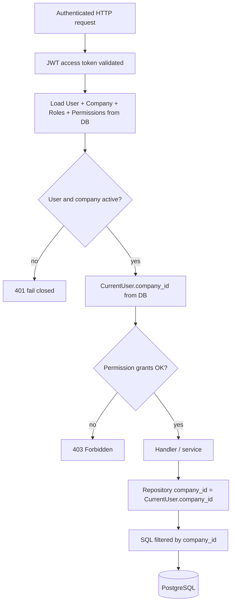

# NexusOS multi-tenant architecture

**Authoritative isolation mechanism today:** application-level tenant scoping + relational constraints.  
**PostgreSQL Row-Level Security (RLS):** **not implemented** (deferred). See the historical decision note under `ai-business-os/ai-business-os/docs/reports/Part-03.1/RLS-Decision-Note.md` — some early paragraphs there describe a pre-CRM state and are outdated regarding `BaseRepository` adoption.

---

## 1. Tenant identity

| Concept | Implementation |
|---------|----------------|
| Tenant | `Company` model |
| Membership | `User.company_id` → company |
| Login disambiguation | Client sends **company slug** with credentials (`auth` schemas/services) |
| Post-login tenant | Taken from the authenticated **user row in the database** |

After login, authenticated APIs are not designed to accept a client-supplied “active tenant” header or body field for scoping. Handlers receive `CurrentUser.company_id` from dependencies.

---

## 2. How tenant context is established

Primary code: `ai-business-os/ai-business-os/backend/app/dependencies/auth.py`

1. **`get_current_user`**  
   - Requires `Authorization: Bearer`.  
   - Decodes JWT (`decode_token`, expected type `access`).  
   - Builds a provisional `CurrentUser` from claims (`sub`, `company_id`, `role`).  
   - **Does not** load permissions; **must not** be used alone for AuthZ decisions.

2. **`get_current_active_user`** (authoritative for guarded routes)  
   - Loads `User` by primary key from the JWT `sub`.  
   - Rejects missing/soft-deleted/inactive/suspended users.  
   - Rejects inactive/soft-deleted companies.  
   - Hydrates permissions from DB role grants.  
   - Sets `company_id=user.company_id` **from the database row**, not from a client field.  
   - Role name is derived from loaded roles (deterministic ordering noted in code comments).

3. **`require_permission` / `require_roles`**  
   - Depend on `get_current_active_user`.  
   - Deny-by-default if required grants/roles are absent.

---

## 3. Repository-layer isolation

Primary code: `app/repositories/base.py`

For models using `TenantMixin`:

- Missing `company_id` on the repository → **fail closed** (`TenantIsolationError` / equivalent path).
- Reads: `WHERE company_id = :trusted_company_id` (and soft-delete filters as applicable).
- Creates: assign `entity.company_id` from the trusted context.
- Updates/deletes/archives: load through tenant-scoped queries first.
- Pagination/sort: server-side clamps; sort fields allowlisted.
- Mass assignment: privileged columns (`company_id`, ids, audit fields) protected.

Domain repositories subclass `BaseRepository`, including CRM (`app/repositories/crm.py`), HR, finance, inventory, projects, and related modules. API routers construct repositories with `company_id=current_user.company_id`.

**Auth service** intentionally uses direct queries for login/register (no tenant context yet). That is expected and documented in service comments.

---

## 4. Database constraints (not RLS)

In addition to application filters, the schema uses **composite foreign keys** and tenant columns so that a child row in tenant A cannot reference a parent in tenant B at the relational level (see model/migration definitions under `app/models` and `migrations/`).

This is **database-enforced referential integrity**, not PostgreSQL RLS.

---

## 5. Application-level vs database-enforced isolation

| Mechanism | Status |
|-----------|--------|
| Server-derived `company_id` on requests | **Implemented** |
| `BaseRepository` `company_id` filters | **Implemented** (live callers across CRM/HR/finance/…) |
| Composite tenant FKs | **Implemented** (schema) |
| PostgreSQL RLS policies / `SET LOCAL` | **Not implemented** |
| Separate DB roles without `BYPASSRLS` | **Not implemented** |

**Do not claim “database RLS isolation” for NexusOS.** Claiming “tenant-safe” means: application paths that use the above repository/dependency pattern, plus FK constraints — subject to the residual risks below.

---

## 6. CRUD / list / identifier handling

| Operation | Enforcement pattern |
|-----------|---------------------|
| List | Repository query always constrained by `company_id` |
| Get by id | Fetch via tenant-scoped get; cross-tenant UUID → not found / forbidden path |
| Create | `company_id` forced from context |
| Update / soft-delete | Load scoped entity, then mutate |
| User-supplied ids | Treated as identifiers **within** tenant scope, not as tenant selectors |
| Pagination | `DEFAULT_PAGE_SIZE` / `MAX_PAGE_SIZE` clamps |

Exact HTTP status for cross-tenant ID probing depends on the endpoint (often indistinguishable “not found” vs forbidden). Security tests exercise cross-tenant relationship cases under `backend/tests/security/`.

---

## 7. Request-flow diagram

---

## 8. Testing evidence

| Suite / area | What it establishes |
|--------------|---------------------|
| `tests/test_tenant_isolation.py` | Repository fail-closed / filter behavior |
| `tests/security/test_cross_tenant_relationships.py` | Cross-tenant relationship / access regressions |
| `tests/security/test_authorization.py` | Permission / role enforcement |
| Domain `tests/test_*_api.py` | Module APIs operate in a created company context |

**CI** runs `tests/security/` and `tests/test_tenant_isolation.py` as part of the backend gate (see root `.github/workflows/ci.yml`).

---

## 9. Residual risks and unverified areas

Treat these as open verification topics — not as confirmed breaches:

1. **Any code path that queries tenant tables without `BaseRepository` or an equivalent explicit `company_id` filter** (exports, ad-hoc SQL, future workers). Auth paths are intentional exceptions.
2. **Background jobs / admin scripts** — none audited here as a complete inventory; when added, they need explicit tenant context.
3. **AI tool handlers** (`app/services/ai_tools.py`) — designed to receive `CurrentUser` and use tenant scope; treat tool surface as high sensitivity and keep covered by tests.
4. **Stripe webhooks** — resolve tenant from Stripe metadata/objects; incorrect metadata mapping would be a cross-tenant risk class (signature proves Stripe origin, not correct tenant mapping). Covered partly by webhook tests; full production mapping remains **ops-sensitive**.
5. **No RLS** — a compromised app credential to PostgreSQL can read across tenants at the SQL level.
6. **Stale comments** in `auth_service.py` / old RLS note sections claiming “zero BaseRepository callers” are **documentation/code-comment drift** relative to current CRM+ modules (do not treat those comments as current architecture).

---

## Related files (entry points)

- `backend/app/dependencies/auth.py`
- `backend/app/repositories/base.py`
- `backend/app/repositories/crm.py` (and other domain repos)
- `backend/app/api/v1/router.py`
- `backend/tests/test_tenant_isolation.py`
- `backend/tests/security/test_cross_tenant_relationships.py`
