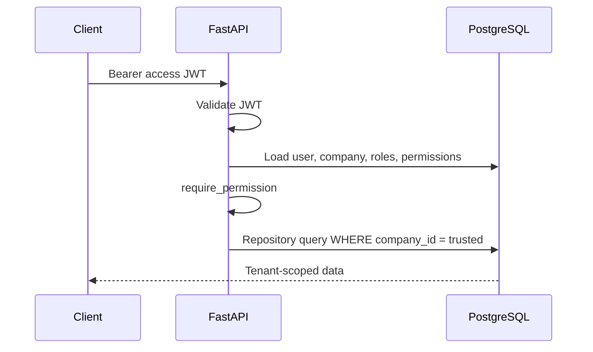

# NexusOS — Portfolio Update Package

**Source of truth:** [NEXUSOS_MASTER_AUDIT.md](NEXUSOS_MASTER_AUDIT.md)  
**Do not use** August 2026 “modules not yet built” portfolio copy without replacement.  
Originals preserved under `docs/portfolio/_originals/`.

---

## A. Main project summary (card / profile)

**NexusOS** is a multi-tenant business operations platform: a React SPA and FastAPI API share one identity model, permission system, and tenant boundary while hosting CRM, HR, finance, inventory, projects/tasks, reporting, notifications, settings, an AI assistant, and Stripe billing/Connect.

Engineering focus: tenant identity is derived from the authenticated user’s database record (not accepted from client fields after sign-in); authorization reloads roles and permissions from PostgreSQL on protected requests; data access goes through tenant-scoped repositories plus composite foreign keys. PostgreSQL RLS is deliberately deferred. Redis is used for auth rate-limit counters and fails open if unavailable. Stripe and OpenAI integrations are environment-gated.

---

## B. Detailed project description (case-study length)

### Problem

Business tools often ship module-by-module and retrofit multi-tenancy later. That makes tenant filters a convention every query must remember. NexusOS inverts the order: identity, authority, and isolation are platform infrastructure.

### System design

- **Client:** React 19, TypeScript, Vite 6, React Router 7, TanStack Query, Zustand for session/UI, Stripe Elements for in-app checkout.
- **API:** FastAPI with middleware (CORS, security headers, request context), thin routers, services, SQLAlchemy 2 async, Alembic.
- **Data:** PostgreSQL (asyncpg); Redis for distributed rate-limit counters only.
- **Integrations:** Stripe (SaaS billing + Connect + webhooks), OpenAI (assistant + tools).

### Tenant isolation

After login (company slug + credentials), `get_current_active_user` loads the user and sets `company_id` from the database. Repositories require that context and filter by `company_id`. Composite FKs block cross-tenant relationships. **RLS is not implemented.**

### Authorization

`require_permission` / `require_roles` depend on DB-hydrated grants. Token role claims are not the AuthZ source of truth.

### Trade-offs (honest)

- Rate limiting fails **open** if Redis errors (availability over strict deny).
- CI runs a **scoped** backend pytest gate, not always the entire suite.
- Stripe/AI need correct env flags/keys; without them features stay unavailable (fail-closed / fail-soft).
- Edge/WAF (e.g. Cloudflare) may sit in front of production but is **not** proven from this repository alone.

### What is implemented vs partially verified

**Implemented (code + APIs/UI):** auth lifecycle, RBAC, CRM, HR, finance, inventory, projects/tasks, reports, dashboard metrics, notifications, settings, design system/shell.

**Implemented, partially verified:** AI assistant (needs API key), Stripe billing/Connect (needs Stripe platform config), production HSTS/trusted-proxy/Cloudflare settings (ops dashboards).

**Planned:** PostgreSQL RLS.

---

## C. Verified technology stack (badges / lists)

**Languages:** TypeScript, Python  

**Frontend:** React 19, Vite 6, React Router 7, TanStack Query 5, Zustand 5, React Hook Form, Tailwind CSS, Radix UI, Recharts, Stripe.js  

**Backend:** FastAPI, Pydantic v2, SQLAlchemy 2.0 (async), Alembic, Argon2, PyJWT, structlog, Redis client, Stripe SDK, OpenAI client  

**Data:** PostgreSQL, Redis (rate limits)  

**Tooling:** GitHub Actions, pytest, Vitest, ruff, TypeScript compiler, Docker Compose  

**Optional / external (ops):** Vercel (FE hosting), Railway (API hosting), Cloudflare (DNS/TLS/WAF — configuration unverified in-repo)

**Do not badge as used unless true:** Kubernetes, GraphQL, RLS, “enterprise SSO”, compliance seals.

---

## D. System architecture diagram specification

### Required components and edges

```
[Browser SPA]
  → [Static host / CDN] (label: hosting unverified in-repo)
  → [Optional edge: DNS/TLS/WAF] (label: e.g. Cloudflare — settings unverified)
  → [FastAPI middleware: CORS, headers, request context]
  → [API routers /api/v1]
      ├─ auth, health
      ├─ crm, hr, finance, inventory, projects
      ├─ reports, dashboard, notifications, settings
      ├─ assistant, billing
      └─ webhooks/stripe (signature auth)
  → [Auth dependencies: JWT + DB revalidation + permissions]
  → [Services]
  → [Tenant-scoped repositories]
  → [(PostgreSQL)]
  → [(Redis rate limits)] dashed
  → [Stripe API] / [OpenAI API] dashed from services
```

### Status sidebar (replace old auth-only list)

- ● Auth, Design system  
- ● CRM, HR, Finance, Inventory, Projects/Tasks  
- ● Reports, Dashboard API, Notifications, Settings  
- ◐ AI assistant (env key)  
- ◐ Stripe billing/Connect (env flags)  
- ○ PostgreSQL RLS (planned)

### Mermaid (export to PNG for portfolio)

```mermaid
flowchart TB
  UI[React SPA] --> Edge[Edge DNS/TLS optional]
  Edge --> MW[FastAPI middleware]
  MW --> R[/api/v1 routers]
  R --> A[AuthZ dependencies]
  A --> S[Services]
  S --> Repo[Tenant repositories]
  Repo --> PG[(PostgreSQL)]
  R -.-> RD[(Redis limits)]
  S -.-> ST[Stripe]
  S -.-> AI[OpenAI]
```

### Remove from old diagram

- “8 auth routes” as the entire live API  
- “Business modules = navigation placeholders”  
- “Tenant-scoped repository not yet on live routes”  
- “Dashboard = fixture data only”

---

## E. Multi-tenant architecture diagram specification

Keep the existing flow (token → DB identity → permissions → scoped queries → FK constraints). Updates:

1. Change any caption implying repositories are unused → **“BaseRepository subclasses used by CRM/HR/finance/inventory/projects APIs.”**  
2. Keep **“RLS not implemented.”**  
3. Optional callout: webhooks resolve tenant from Stripe objects/metadata (signature ≠ tenant correctness).  

Mermaid:



---

## F. Security architecture diagram specification

Keep layers 01–07 from the current security PNG (they largely match code). **Must fix:**

- Layer 07 note “scoped repository not yet on live routes” → **Incorrect** — replace with “Tenant-scoped repositories on live domain routes; RLS deferred.”

Keep “Deliberately not claimed”: RLS, CSP deferred, no access-token denylist, rate-limit fail-open.

Cloudflare: show as **optional external edge** with caption **“Configuration unverified in repository.”** Do not show specific WAF rules as active.

---

## G. Screenshot update checklist

| Asset | Accurate? | Required changes |
|-------|-----------|------------------|
| `docs/architecture/system-architecture.png` | **No** | Regenerate per §D |
| `docs/architecture/security-architecture.png` | **Mostly** | Fix repository live-routes claim; clarify Cloudflare unverified |
| `docs/architecture/multitenant-request-flow.png` | **Mostly** | Caption update for live repositories |
| `docs/screenshots/dashboard-*.png` | UI OK | Captions: prefer “live metrics API” only if demo uses real API; avoid “AI module complete” unless assistant page shown |
| `docs/screenshots/sign-in.png` | Yes | Keep; company slug login is accurate |
| `docs/screenshots/command-capture.png` | Yes | Keep as shell UX |
| Portfolio Screely dashboards (external) | Unknown age | Re-capture from current app if UI changed; avoid claiming modules not opened in shot |
| Manifest “AI insights as first-class module” | Overstated if only dashboard panel | Prefer separate screenshot of `/assistant` or soften caption |

**PNG/PDF regeneration (2026-10-18):** architecture PNGs under `docs/architecture/` and `~/Documents/NexusOS Portfolio/03 Architecture/` were regenerated; portfolio PDFs under `~/Documents/NexusOS Portfolio/04 Portfolio Text/` were regenerated from corrected FINAL Portfolio Text Markdown. Originals preserved in `docs/portfolio/_originals/` and portfolio `_backup_2026-10-18/` folders.

---

## H. Project PDF update specification

### Accessibility

Full page-by-page PDF inspection **could not be completed**: `pdftotext` / `pypdf` unavailable in the audit environment. PDFs exist at:

- `~/Documents/NexusOS Portfolio/04 Portfolio Text/NEXUSOS-*.pdf`
- `~/Documents/NexusOS_Security_Architecture*.pdf`
- `~/Documents/NexusOS-Engineering-Guide.pdf`, Engineering Bible PDFs
- Repo: `.../docs/reports/Part-01/06-Engineering-Report.pdf`

`strings` on Security Architecture PDF shows keywords including Cloudflare — treat active WAF claims as **unverified**.

### Replacement outline (when you regenerate PDFs)

1. Title / role / stack (use §C)  
2. Problem & tenancy-first approach  
3. System architecture (new diagram)  
4. Multi-tenant flow (updated diagram)  
5. Security layers (updated diagram)  
6. Module status table (from master audit §10)  
7. Stripe & AI (partially verified)  
8. Testing & CI honesty (scoped gate)  
9. Limitations & RLS deferred  
10. Links to GitHub docs  

**Source markdown for PDFs** should be the corrected files in this package / `docs/portfolio/`, not August “modules not built” text.

---

## I. Interview talking points

1. **Why this architecture?** Thin routers, services for logic, dependencies for identity — so features cannot skip AuthZ/tenancy.  
2. **Tenant isolation?** After sign-in, `company_id` comes from the DB user row; repositories filter by it; composite FKs; **no RLS**.  
3. **Authorization?** Permissions reloaded from DB on `get_current_active_user`; token role is not trusted for allow decisions.  
4. **Redis?** Rate-limit counters only; on Redis errors the limiter **fails open** (logged).  
5. **Cloudflare?** Useful edge for DNS/TLS/WAF, but it doesn’t replace app AuthZ/tenancy; dashboard settings not proven from git.  
6. **App isolation vs RLS?** App filters + FKs run in the app/DB constraints; RLS would enforce in the DB engine even if SQL forgot a filter — we deferred that.  
7. **What’s real today?** Domain modules and Stripe/AI code are real; older portfolio “placeholders only” is outdated. Stripe/AI/production edge need env/ops proof.  
8. **CI honesty?** Security/tenant tests are gated; full pytest isn’t always the merge gate.

---

## Ready-to-paste corrected portfolio summary file

Saved also as `docs/portfolio/02-NexusOS-Portfolio-Summary.CORRECTED.md`.

```markdown
# NexusOS

**A multi-tenant business operations platform where identity, authorization, and tenant isolation are platform infrastructure — with live CRM, HR, finance, inventory, projects, reporting, and gated Stripe/AI integrations.**

## Overview

NexusOS unifies business capabilities behind one React application shell and one FastAPI service: shared authentication, RBAC with database re-validation, and application-level tenant isolation. Product modules are implemented as APIs and UI on that foundation. PostgreSQL row-level security is intentionally deferred.

## My Role

Sole engineer — architecture, backend, frontend, data model, security controls, design system, tests, and CI.

## Highlights

- Tenant scope derived from the authenticated user’s database record after sign-in
- Permissions reloaded from PostgreSQL on protected requests
- Refresh-token rotation with reuse detection
- Tenant-scoped repositories + composite foreign keys (not RLS)
- Redis rate limits on auth endpoints (fail-open if Redis is down)
- Stripe platform billing / Connect and OpenAI assistant behind environment gates

## Technology

React 19, TypeScript, Vite, React Router, TanStack Query, Zustand, FastAPI, SQLAlchemy 2 async, Alembic, PostgreSQL, Redis, Argon2, Stripe, OpenAI, GitHub Actions, pytest, Vitest

## Status

**Implemented:** auth, RBAC, CRM, HR, finance, inventory, projects/tasks, reports, dashboard metrics, notifications, settings, design system.

**Implemented, partially verified:** AI assistant (API key), Stripe billing/Connect (flags + secrets), production edge/HSTS/proxy settings.

**Planned:** PostgreSQL RLS.

See the repository `docs/NEXUSOS_MASTER_AUDIT.md` for evidence.
```

---

## Sync actions for external folder (manual)

Copy corrected summary/case-study into:

`~/Documents/NexusOS Portfolio/FINAL Portfolio Text/`

**after** backing up the August versions (already copied into `docs/portfolio/_originals/external-text/`).

Do not commit secrets. Commit repo docs only when you approve.
