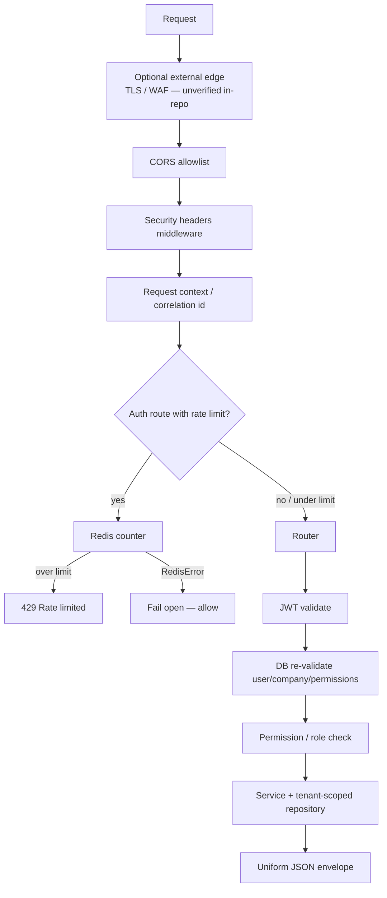

# NexusOS security architecture

This document describes **security controls implemented in application code** and residual risks.  
It is **not** a claim of independent audit, penetration test, or compliance certification.

Vulnerability reporting process: [../SECURITY.md](../SECURITY.md).

---

## 1. Security request flow

---

## 2. Identity and authentication

| Topic | Implementation | Primary files |
|-------|----------------|---------------|
| Password hashing | Argon2 via `argon2-cffi` | `app/core/security.py`, auth service |
| Access JWT | Signed, algorithm-pinned; type must be `access`; short-lived | `app/core/security.py`, config expiry settings |
| Refresh tokens | Server-side session records; rotation; reuse detection revokes sessions | `app/services/auth_service.py` |
| Email verification / password reset | Token flows in auth service | `app/api/v1/auth.py`, auth service |
| Active checks | Suspended/inactive user or company → 401 on `get_current_active_user` | `app/dependencies/auth.py` |
| Login enumeration | Generic failure messaging (by design in auth service) | auth service |
| Rate limiting | Redis fixed window on selected auth endpoints | `app/core/rate_limit.py` |

**JWT vs database authority:** route guards that authorize use `get_current_active_user`, which **reloads roles/permissions from PostgreSQL**. Token-embedded role is not the AuthZ source of truth.

---

## 3. Authorization

| Mechanism | Behavior |
|-----------|----------|
| `require_permission("a", "b")` | Caller must hold **all** listed permissions (AND) |
| `require_roles("owner", …)` | Coarse role-name check |
| Permission catalogue | Seeded globally; granted per tenant role at registration | `app/db/seed.py` |
| Deny by default | Missing permission → `ForbiddenError` |

Frontend mirrors some gates via `PermissionRoute` / related wrappers under `frontend/src/routes/`. UI hiding is **not** a security boundary; API enforcement is.

---

## 4. Data protection and tenancy

See [MULTI_TENANCY.md](MULTI_TENANCY.md).

Summary:

- Server-derived `company_id`
- Tenant-scoped repositories
- Composite FKs
- **No PostgreSQL RLS**
- Mass-assignment protections on privileged columns in `BaseRepository`

Secrets: use environment variables / platform secret stores. Templates in `.env.example` use empty placeholders. Never commit `.env` / `.env.local`.

---

## 5. Application and API security

### CORS

- Configured via `CORS_ORIGINS` (JSON array).
- Production validation exists in settings (reject unsafe configs when `ENVIRONMENT=production` as coded).

### Security headers

`app/middleware/security_headers.py` sets at least:

- `X-Content-Type-Options: nosniff`
- `X-Frame-Options` (see file for exact value)
- `Referrer-Policy`
- `Strict-Transport-Security` when `HSTS_ENABLED` **or** resolved request scheme is HTTPS via trusted client identity

**Production HSTS enablement** depends on deployment config (`HSTS_ENABLED`, trusted proxy mode). Treat live header presence as **deployment-verified**, not guaranteed by code defaults (`HSTS_ENABLED` defaults **false**).

### Trusted proxy / client IP

`app/core/client_ip.py` + `TRUSTED_PROXY_MODE` / `TRUSTED_PROXY_NETWORKS` in config.

- Default mode is conservative (`none` unless configured).
- Universal CIDRs like `0.0.0.0/0` are rejected by validators (covered in Part 3.1 security reports/tests).
- Client IP feeds **rate limiting**, not tenant selection.

Live Railway/proxy CIDR correctness is **ops-verified / unverified in this doc pass**.

### Rate limiting and Redis failure mode

From `RateLimiter.check` docstring and code:

> Fails open (allows the request) on any Redis-level error, logging a warning.

So Redis outage **does not** block auth endpoints; it **disables** the limiter for that request. This is an explicit residual risk.

### Error handling

Domain exceptions map to generic client-safe messages; internals should not leak in production responses. Security tests cover aspects of exception logging / redaction.

### Stripe webhooks

- Unauthenticated HTTP endpoints under `/api/v1/webhooks/stripe/…`
- Signature verification required; missing secret → unavailable / fail-closed behavior via stripe config helpers
- Bad signature → rejected (observed 400 in prior production probes; treat live status as ops-dependent)

Platform billing and Connect processing are gated by `STRIPE_BILLING_ENABLED` / `STRIPE_TENANT_PAYMENTS_ENABLED` (default **false**).

---

## 6. Cloudflare (external edge)

### Why use an edge provider

Placing DNS and TLS (and optionally WAF/DDoS/bot mitigation) in front of the origin reduces direct exposure of the application host to volumetric and some application-layer abuse. That layer is complementary to:

- Authentication / session security  
- Authorization / RBAC  
- Tenant isolation  
- Input validation  
- Webhook signature checks  

### What this repository proves

| Claim | Status |
|-------|--------|
| App implements its own AuthN/AuthZ/tenant filters | **Verified in code** |
| Cloudflare zone / proxy / WAF rules enabled for production hostnames | **Unverified** (no Cloudflare IaC or dashboard export in repo) |
| Specific WAF managed rulesets, bot fight mode, edge rate limits | **Unverified** |
| Origin only accepts Cloudflare IPs | **Unverified** |

If production DNS for public hostnames uses Cloudflare, document that in ops runbooks with screenshots or API exports — **outside** this repository audit.

---

## 7. Security testing evidence

| Evidence | Establishes |
|----------|-------------|
| `backend/tests/security/` | AuthZ, cross-tenant relationships, headers/proxy/rate-limit related cases, logging redaction aspects |
| `backend/tests/test_tenant_isolation.py` | Repository isolation fail-closed |
| CI backend job | Runs security + tenant-isolation + selected regressions |
| Frontend route/permission tests | UX gating regressions — not API security proof |

**Implemented ≠ security-tested for every route.** New endpoints need explicit permission + tenant tests.

---

## 8. Residual risks (explicit)

1. Rate limit **fail-open** on Redis errors.  
2. No PostgreSQL RLS — DB credential compromise bypasses app filters.  
3. Stripe/AI keys and enable flags are environment-dependent; misconfiguration can disable payments or (if mis-set) enable unexpected modes — keep fail-closed flags false until ready.  
4. Trusted-proxy misconfiguration can skew IP-based limits or HTTPS detection.  
5. Full backend pytest suite is **not** the CI merge gate.  
6. Historical docs/comments may claim outdated isolation reach — trust current `dependencies/auth.py` + repositories.  
7. Edge/WAF posture unverified from Git alone.

---

## Related documents

- [ARCHITECTURE.md](ARCHITECTURE.md)
- [MULTI_TENANCY.md](MULTI_TENANCY.md)
- [IMPLEMENTATION_STATUS.md](IMPLEMENTATION_STATUS.md)
- Part 3.1 engineering reports under `ai-business-os/ai-business-os/docs/reports/Part-03.1/`
